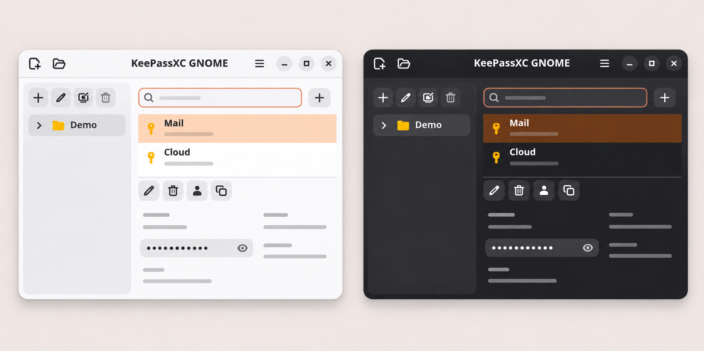

# KeePassXC GNOME



Ubuntu 26.04 / GNOME 50 / Wayland 向けのパスワードマネージャーです。
KeePassXCのコアとGTK4・libadwaitaを組み合わせた独立プロジェクトで、本家KeePassXCの公式版ではありません。

## 主な機能

- KDBX 3.1 / 4.0 / 4.1の読み書き、作成・保存・ロック
- 既存DBのキーファイル単独・マスターパスワード併用での解除
- Chrome安定版（deb）との連携、許可したHTTPSサイトへのログイン情報入力
- GNOME Waylandで、選択したエントリーをフォーカス中の入力先へ自動入力
- グループとエントリーの管理、検索、プレビュー、アイコン選択
- パスワード生成、ユーザー名・パスワードのコピー
- エントリーごとのTOTP設定、認証コードと残り時間の表示、自動更新。[TOTPの使い方](docs/user-guide.md#totp)
- 未保存表示、保存時のバックアップ、未保存の変更の復旧
- 日本語・英語の自動選択、システムの明暗・アクセントカラーへの追従

暗号処理とKDBXの読み書きにはKeePassXCの実装を使用します。編集画面のEnterで変更を確定し、メイン画面の保存でファイルに書き込みます。詳しくは[利用ガイド](docs/user-guide.md)を参照してください。

## インストール

[v0.5.0の配布ページ](https://github.com/NBE03xxx/keepassxc-gnome/releases/tag/v0.5.0)から、debと`SHA256SUMS`をダウンロードしてください。対応環境はUbuntu 26.04（amd64）です。

```bash
sha256sum keepassxc-gnome_0.5.0-3_amd64.deb
# 表示された値をSHA256SUMS内の同名ファイルの値と照合
sudo apt install ./keepassxc-gnome_0.5.0-3_amd64.deb
```

アプリ一覧から「KeePassXC GNOME」を起動します。右上のデータベースメニューの「このアプリについて」でバージョンを確認できます。本家KeePassXCと共存でき、明示済みのファイル関連付けは変更しません。

## Auto-Typeで日本語IMEを自動切り替え

**日本語変換を有効にしたままAuto-Typeを使うには、同梱のGNOME Shell拡張を有効にしてください。** ショートカットを押すと一時的に直接入力へ切り替わり、入力後に元の入力ソースへ戻ります。

1. [インストール](#インストール)の手順でdebを導入し、GNOMEから一度ログアウトしてログインします。
2. 端末で次のコマンドを一度実行します。

   ```bash
   gnome-extensions enable keepassxc-auto-type-ime@keepassxc-gnome
   ```

3. KeePassXC GNOMEで「自動入力」を準備します。「IMEは一時的に自動で切り替わります」と表示されたら、入力先でショートカットを押します。

**動作確認済みの構成は、GNOME 50 Waylandの「日本語（Mozc）」と「日本語」の組み合わせです。** ほかのIMEでも、GNOMEが管理するIBus入力ソースと直接入力用の配列があれば切り替えられる設計ですが、動作は未検証です。「ウィンドウごとに異なる入力ソース」の設定はオフにします。拡張を使わない場合は、入力先を先に直接入力にします。[Auto-Typeの詳しい手順](docs/user-guide.md#自動入力auto-type)

## 制限

- **指紋認証や顔認証など、生体認証によるデータベースの解除**は未対応です。
- **他のアプリに資格情報を提供するSecret Service（秘密サービス）の統合**は未実装です。

日常的な短時間の個人利用を対象としています。長時間・反復操作ではメモリ使用量が増加する既知の問題があります。大切なデータベースはバックアップを取り、本家との同時編集を避けてください。

ブラウザー連携には、Chrome Web Store版のKeePassXC-Browserが必要です。接続とHTTPSフォームへの入力はアプリで許可します。フォームの送信はブラウザーで行います。[ブラウザー連携の手順](docs/user-guide.md#ブラウザー連携)を参照してください。

自動入力は、GNOMEでキーボード操作を許可してから、利用者が入力先でショートカットを押したときに動作します。対応する命令とキー配列には制限があります。[自動入力の手順](docs/user-guide.md#自動入力auto-type)を参照してください。

YubiKeyでの解除は未対応です。キーファイルの生成・新規DBへの設定・既存DBの鍵変更には本家KeePassXCを使用してください。保持できない形式・設定のデータは理由を示して読み込みを拒否します。既存のカスタムアイコン画像は保持しますが、画面では汎用アイコンを表示します。

## ソースからのビルド

```bash
bash tools/fetch-upstream.sh
python3 tools/bootstrap-dev.py
source tools/dev-env.sh
cmake -S . -B build -G Ninja -DKPXC_GNOME_DEVELOPMENT_UI=OFF
cmake --build build --parallel 4
ctest --test-dir build --output-on-failure
./build/bin/keepassxc-gnome
```

Ubuntu 26.04のコンパイラー、Git、Ninja、pkg-config、gettext等が必要です。`bootstrap-dev.py`は追加の開発依存をプロジェクト内へ展開します。[ビルド・配布手順](docs/distribution-maintenance.md)も参照してください。

## ライセンス

[GNU GPL version 2](LICENSE.GPL-2)または[version 3](LICENSE.GPL-3)。KeePassXCと依存ライブラリの著作権・ライセンス表示を同梱しています。バイナリと対応ソースを同時に提供します。
