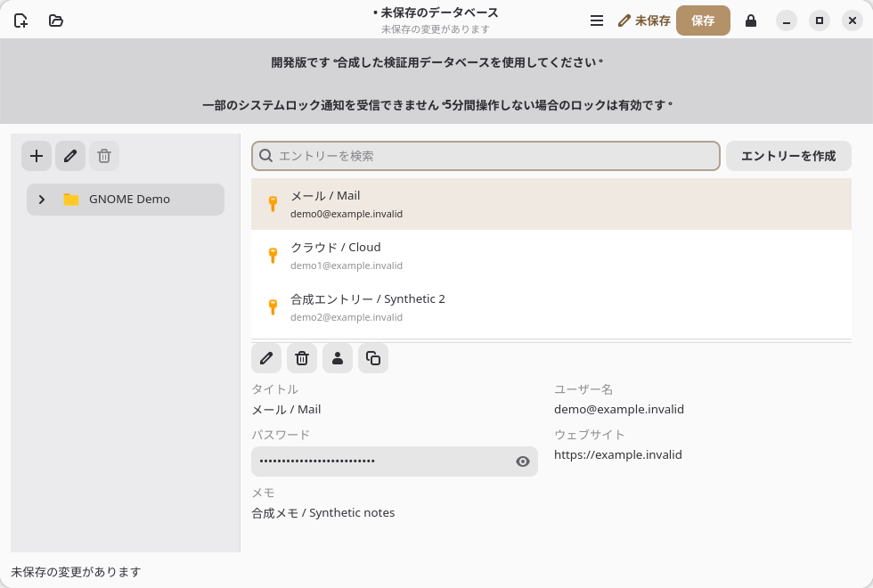
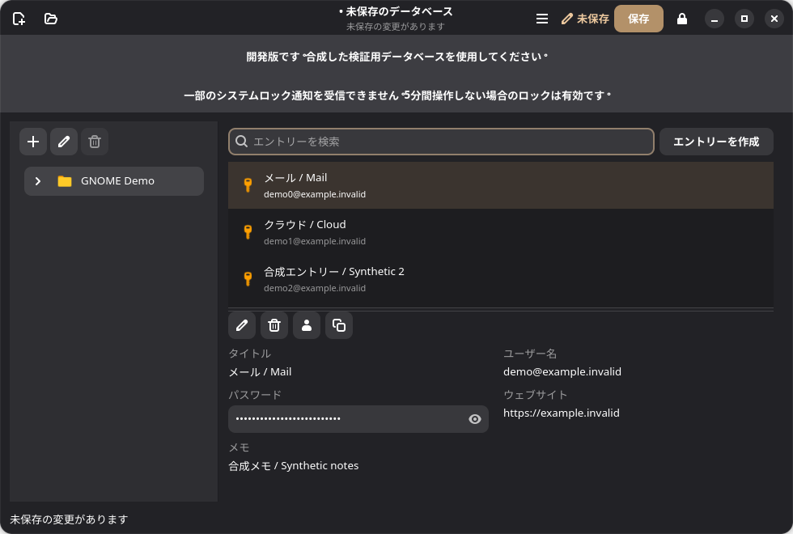

# Enterによる既定操作と選択色の20%混色

2026-11-14。利用者の追加UI依頼への対応。暗号・KDBX・worker・本家参照は変更しない。

## 操作

| 場面 | Enter / テンキーEnter |
| --- | --- |
| DB作成の名前・パスワード・確認欄 | 名前とパスワードが非空で、確認値が一致すれば「作成」 |
| DB解除のパスワード欄 | 「ロック解除」。空欄では実行しない |
| エントリーのタイトル・ユーザー名・パスワード・URL | 「エントリーを保存」と同じ確定操作 |
| グループ名 | 「保存」。空欄では実行しない |
| 複数行メモ | 改行。保存操作へ変換しない |
| 「生成」等の補助ボタンにフォーカス中 | そのボタンの通常操作。既定の保存を横取りしない |
| 終了時の保存確認 | 従来の既定の保存。Escapeはキャンセル |
| 削除・破棄・clipboard同意の確認 | 既定のキャンセルを維持。色が付いた危険な操作を無条件に実行しない |

エントリーのEnterは編集内容の確定であり、DBファイルへの自動保存を追加するものではない。ファイルへ保存するまで「未保存」の印を残し、メイン画面の保存または終了時の保存で書き込む。

入力欄のGTK / libadwaita標準の `activates-default` と、編集ダイアログの `default-widget` を設定した。全体でEnterキーを捕捉する独自ハンドラーは追加していない。これによりメモ・ボタン・アイコン選択などの本来のキー処理を保つ。日本語IMEの変換確定はGTKの入力メソッド処理に委ねる。実際のIMEによる変換中の新しい実機試験は未実施。

DB作成では入力条件が満たされるまで既定の作成ボタンを無効にする。空欄・確認不一致のEnterでダイアログを閉じず、入力を保持する。エントリーも空タイトルの保存ボタンを無効にする。メモ欄にはアクセシビリティ用の欄名を追加した。

根拠：`src/main.cpp` の `credentials` / `groupName` / `edit`。[AdwDialogの既定widget](https://gnome.pages.gitlab.gnome.org/libadwaita/doc/1-latest/method.Dialog.set_default_widget.html)、[AdwEntryRowの既定操作](https://gnome.pages.gitlab.gnome.org/libadwaita/doc/1.7/method.EntryRow.set_activates_default.html)。既存SDKで利用でき、新規依存は不要。

## 選択色

エントリーの選択背景を `color-mix(in srgb, var(--accent-bg-color) 20%, var(--view-bg-color))` に変更する。20%は本プロジェクトの固定値。アクセント20%＋標準view背景80%という混色で見かけの濃さを下げる。行全体にopacityを設定していないため、文字・アイコンまで20%に薄くしない。文字色はライト・ダークそれぞれの標準 `--view-fg-color` とする。選択中のユーザー名に追加の薄さは適用しない。

主要ボタンのアクセント色、システムの色変更への追従、高コントラスト通知中のtoolkit標準スタイルへの委譲は維持する。通常環境のGNOME設定は書き換えない。根拠は `src/gnome/Appearance.h`。[libadwaitaのCSS変数](https://gnome.pages.gitlab.gnome.org/libadwaita/doc/main/css-variables.html)。

## 検査

`tests/default_keys_ui_probe.cpp` は製品と同じWindowを別の試験用実行ファイルへ組み込み、私有GNOME内で `tests/ui_default_keys.py` / `tests/private_keyboard.py` が**実際のReturn / KP_Enter**を送る。activateシグナルを直接発火してEnterの代用にはしない。モデルと再保存した合成KDBXから作成・変更内容を照合する。試験用の状態通知・制御は製品バイナリへ組み込まない。

- 日本語Returnと英語KP_Enterで、DB作成、無効入力での非実行、タイトル・ユーザー名・伏せ字PW・URLの確定、グループ作成／編集、補助ボタンへのフォーカス、メモの改行、終了時保存が成功。
- メモはprobe側で展開して実キー操作を確認する。GTKの版によって保護入力のAT-SPI GrabFocusやMULTI_LINE属性を提供しないため、Tabによる実フォーカス移動と、明示したメモ欄名を使う。メモ展開行のAT-SPI action自体は今回の合格項目に含めない。
- 日英のpolishは各362チェック。10色×ライト／ダークの実ピクセルが20%混色に一致し、文字色とwidgetのopacityが標準値のままであることを照合した。主要保存ボタンが従来のアクセント色を維持することも照合する。
- 通常CTest 23/23が成功。

ログは `build/default-keys-{ja,en}.log`、`build/default-tint-*.log`。共通入口に `tools/test-ui.sh --default-keys` と英語・ASan版を追加した。以降の回帰・ASan・梱包・VM→実機の結果は追記する。GUI全体の生LSan非ゼロ、長時間のメモリ基準未達、高コントラスト・IMEの新しい実機受入は、今回の試験だけで合格へ変更しない。GitHub公開は別途の明示指示を待つ。

### ローカル回帰の確定

実ReturnのASan付き同一シナリオと、20%混色のpolish ASan各検査が成功（GUIはdetect_leaks=0）。保存・復旧、終了時保存、GUI秘密寿命、既存の実Return解除、guard、基本操作も成功した。通常ログインの `fuse.portal` マウントは維持している。新規依存・通常のデスクトップ設定の変更は無い。

## 画面例

合成データ・私有GNOMEで撮った実描画。色は試験内で切り替えた例で、実機の設定を変更していない。上部の監視警告は私有バスの試験条件による。

## 固定したdev11候補とVM

`build/dist/default-actions-tint-candidate/` に次を固定した。基準コミットは `a8e44b219156a54836661f6e3d620b26ebdb6af4`＋未コミットの改修。上流は2.8.0、`1c2f23ef5914c0f442a00533def1689857afb5a7`のまま。後日のVM・実機記録は凍結ソースに追加していない。

| 成果物 | SHA256 |
| --- | --- |
| `keepassxc-gnome-development_0.1.0~dev11-1_amd64.deb` | `ccd72b5baf08a97a33f58ca4cd12bde29ac92944f9d12d14d3b56da5f637ba12` |
| `keepassxc-gnome-development_0.1.0~dev11-1.source.tar.xz` | `1f7e89c8cc815f1b74d1e59af43f5a0126d94a95329094a65893042a252d74ab` |
| `keepassxc-gnome-development_0.1.0~dev11-1_amd64.manifest.json` | `6d5658ef3ca42220146e761ea960293720844bebd9036131843d93279914a81d` |

製品mainは `88b2ff5a046da8533ce59584eaf359f2d79bc8fb2de4945c71e08c273d1d985a`。worker / pickerはdev10と同一で、梱包内容・翻訳・hardening・ライセンス・独立MIME登録・ソースからのconfigureを照合した。凍結ソースの主要変更・試験ファイルが作業ツリーと一致することも確認した。今回の候補を使う完全なクリーン再ビルド・梱包再現試験は再実施していない。

Ubuntu 26.04.1 VMでdev11-1の導入、同一payloadのdev11-2への更新、削除、再導入を検査した。配置先の製品で基本操作、日英の実Return / KP_Enter、日英の終了時保存、20%選択背景、歓迎画面、ファイル関連付け、監視不能時の保護を確認した。今回のVMのpolishは363チェック、寿命107チェック・直近情報26チェックも成功。VMはSDKと異なるlibadwaita1.9.1-0ubuntu0.1 / GTK4.22.4-0ubuntu0.1である。試験後は開発アプリをpurgeし、全パッケージ状態が導入前のSHA256 `59e45b2d14e4c0511b423105c87adae1d57e8cf650aaca213194564c27a73333`と一致し、対象アプリのプロセスが残らないことを確認してVMを停止した。

記録：`.cache/vm-dev11-state.json`、`.cache/vm-dev11-logs/`。新規依存はなく、本家・通常のデスクトップ設定・実データベースへ変更していない。

## 実機反映

利用者が保存・メイン画面まで終了・OS認証の準備完了を回答した後、実機を `0.1.0~dev11-1`へ更新した。直前のAPT計画は開発アプリ1件の更新だけで、新規依存・削除なし。更新後の3実行ファイルは上記manifestと一致した。その他の全APTパッケージ、本家KeePassXCのFlatpak commit、MIME既定設定、ユーザー用本家launcherと候補cacheは不変。通常ログインの `fuse.portal` マウントを維持している。確認スクリプトは当初補助実行ファイルをbin配下として照合したため停止したが、実配置のlibexecへ訂正して全照合に成功した。製品の配置や内容は修正していない。

通常profileへDB引数を渡さず日本語起動し、プロセスの継続動作を確認した。実データベースや利用者の画面内容を取得せず、今回のEnter・色の実機操作は利用者自身の確認に渡す。起動ログには実行環境由来のportal設定／monitorへのAccessDeniedがあり、これはアプリの起動失敗とは判定していないが、この起動だけでportal経由の全設定取得の合格は主張しない。設定変更やportalの再起動は行っていない。

記録：`.cache/dev11-host/{update.plan,install.log,result.json,launch.json}`。Git commit / push・GitHub公開は行っていない。新たな実機IME変換・高コントラストの受入と、従来のメモリ検証の制限を残す。

### 主なソース位置

- `src/main.cpp:813`、`:821`、`:828`：作成入力の既定操作。
- `src/main.cpp:1156`、`:1173`：グループ名の既定操作と主ボタン表示。
- `src/main.cpp:1281`、`:1339`：単一行エントリー入力と編集画面の既定保存。
- `src/gnome/Appearance.h:66`：選択背景の20%混色と標準文字色。
