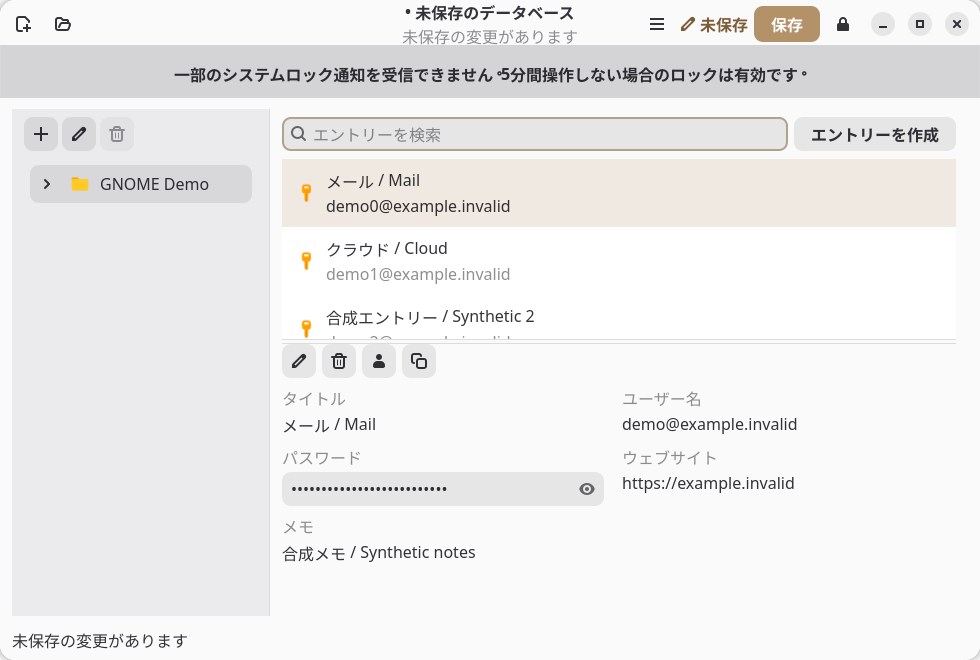
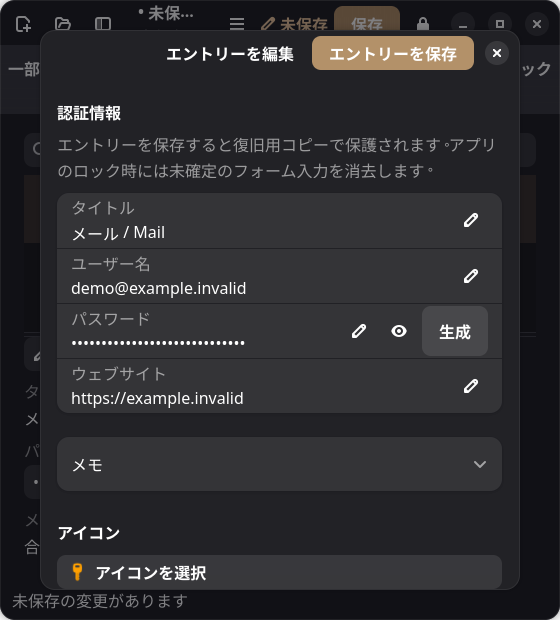

# フォントの読みやすさ（2026-11-15）

利用者の「Codex Desktop Appでも読みやすさの下限」という指定に基づき、標準の文字サイズを拡大した。Codex自体のフォント設定を測定・変更したものではない。

## 変更

- `src/gnome/Appearance.h:49`：本アプリのウィンドウの基本サイズを `1.2rem` にし、GTKの基本サイズから20%拡大する。固定px指定ではなく、GTKのフォント・文字拡大設定を基準にする。本文・グループ・エントリー・検索・プレビュー・入力欄・ボタン・メニュー・アプリ内ダイアログへ継承する。
- 同ファイルの `.subtitle` 指定で、ヘッダーのファイル名・状態と編集欄の項目名を親と同じ文字サイズにする。
- `src/gnome/SummaryList.h:94`：一覧のユーザー名から、文字を82%へ縮小するlibadwaitaの `caption` クラスを外す。タイトルと同じサイズで表示する。
- フォント指定は色の上書きから独立させ、高コントラストでも維持する。既存のtoolkitの配色・輪郭は維持する。

GNOME全体の設定、暗号・KDBX・worker・picker・上流参照への変更、新しい依存はない。OS側のネイティブファイル選択画面は従来どおりシステムの表示を使う。

## 確認済み

既存の製品UI probeを再ビルドし、合成データのみを使う私有GNOME / Waylandで確認した。

- 日英のpolish各362チェック：一覧・プレビュー・グループ・編集、980×660と560×620、明暗、10色のアクセントと20%選択色、ロック時消去、Wayland picker。
- 英語の公開歓迎画面101チェック。幅560の歓迎画面も実描画で確認。
- 日本語の実Return操作：DB作成・無効入力・各エントリー入力の確定・グループ作成／編集・補助ボタン・メモ改行・終了時保存と合成KDBXの内容照合。
- 日英の一覧と狭い編集画面のPNGを目視確認。項目名・値・保存ボタンが収まり、長い説明は折り返される。CSS parserエラーはない。
- `git diff --check` 成功。

ログ：`build/readability-build.log`、`build/readability-polish-{ja,en}.log`、`build/readability-welcome-en.log`、`build/readability-default-keys-ja.log`。私有セッションでは既知のportal設定読取・monitorのAccessDeniedが出るが、各シナリオは正常完了した。

この段階ではソースとローカルビルドへ反映した。続く利用者のT16更新依頼への対応は以下に記録する。実機での最終的な読みやすさと、新しい倍率変更・高コントラストの受入は未確認。

## T16更新候補とVM確認

利用者のT16更新指示に基づき、公開版のパッケージ名とアプリの表示版0.1.0を維持し、Debian revisionを `0.1.0-1` から `0.1.0-2` へ上げた。以前の公開物は変更せず、`build/dist/font-readability/` に次を固定した。

| ファイル | SHA256 |
| --- | --- |
| `keepassxc-gnome_0.1.0-2_amd64.deb` | `159e01b0595753faa7773107d05d88d9b7b2ef2ce912b25606b5ba09b23eed68` |
| `keepassxc-gnome_0.1.0-2.source.tar.xz` | `ac3e0e39bdc6bec38422dd9e4108f52d4a369cb4f96fdc25b4391051b2af70c1` |
| `keepassxc-gnome_0.1.0-2_amd64.manifest.json` | `a34e867e445064609dc786719203a5eb5c7f104a298defbf5516f168dca50e32` |

全ビルド、通常CTest 23/23、梱包検査（対応ソース、hardening、配置先worker/picker、翻訳、独立した関連付け、Gitなしのconfigure）が成功。対応ソース内の `src/gnome/Appearance.h` / `src/gnome/SummaryList.h` が作業ツリーと一致することを照合した。workerとpickerは公開済み0.1.0-1と同じhash。

Ubuntu 26.04.1 VMで、T16に導入済みの公開物と同じ0.1.0-1を導入し、0.1.0-2へ更新した。どちらも本アプリ1件だけの変更で新規依存なし。配置先の3実行ファイルとmanifest、版、`dpkg --verify` が一致した。配置先製品で合成DBの基本操作、日英の拡大表示（polish各363 / 362）、日本語の実Return・メモ改行・終了時保存、公開歓迎102チェックが成功。日英の実描画も回収した。

検証アプリをpurgeし、全パッケージ状態が導入前のSHA256 `59e45b2d14e4c0511b423105c87adae1d57e8cf650aaca213194564c27a73333` と一致し、対象プロセスが残らないことを確認してVMを通常シャットダウンした。`domstate`で停止済みも確認した。ログは `build/readability-{package,package-test,ctest}.log`、`.cache/readability-vm-state.json`、`.cache/readability-vm-logs/`。新規依存・上流参照・実DBの変更・GitHub公開はない。

## T16の更新操作

T16で本アプリが終了していることと、導入済み0.1.0-1から0.1.0-2へのAPT計画が本アプリ1件の更新のみ（追加依存・削除なし）であることを確認した。他の全APTパッケージ、本家KeePassXCのFlatpak commit、MIME既定設定・ユーザー用launcher/cacheの比較基準を保存した。VMで確認した上記debを指定し、利用者がOS認証を行った後、`pkexec`経由で0.1.0-2への更新が完了した。

更新後のパッケージ版0.1.0-2、3実行ファイルのSHA256とmanifest、`dpkg --verify`、日本語catalogが一致した。他の全APTパッケージ、本家KeePassXCのFlatpak commit、MIME既定設定・ユーザー用launcher/cacheは不変。通常profileへDB引数なしで日本語起動し、プロセスの継続動作を確認した。今回の実機での文字の見え方は利用者自身の確認へ渡す。

起動ログには従来と同様のportal設定／monitorへのAccessDeniedがある。今回の起動確認だけでportal経由の全設定取得を確認済みとは扱わず、設定変更やportalの再起動は行っていない。

記録：`.cache/readability-host/{install.plan,packages.before,packages.after,mime.before.json,mime.after.json,original-flatpak.before,install.log,result.json,launch.json,app.log}`。実DBの読取・変更、利用者の画面取得、Git commit/push・公開は行っていない。

## 合成データによる画面例

