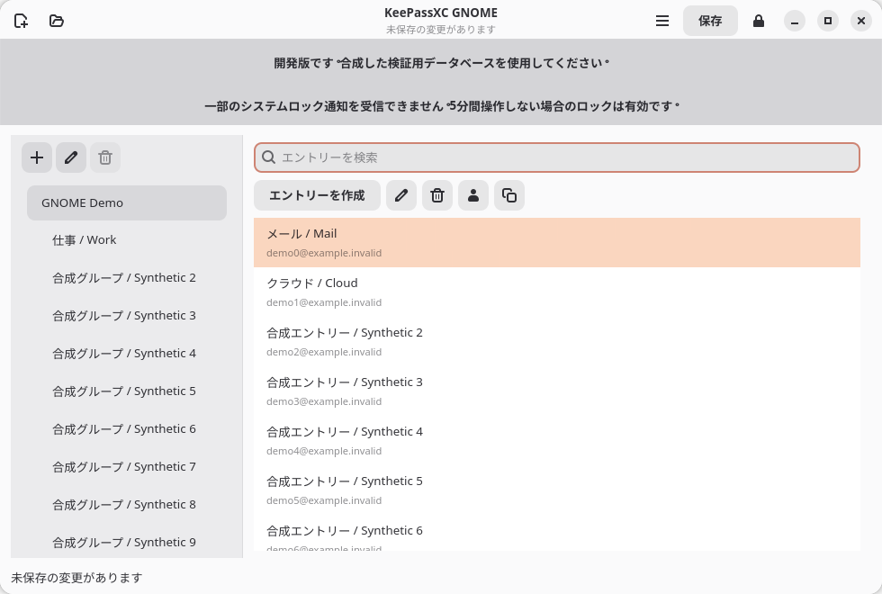

# 手順5：GNOME UI の仕上げ

2026-11-13。Phase 3、最終確認の手順5の記録。合成データと独立した GNOME / Wayland セッションを使用する。配布物の作成・インストール、通常ログインでの実ロック・スリープは手順6〜7の範囲とする。

## 実装と判断の根拠

### GNOME のファイル選択

**確認済みの構造。** `GtkFileDialog` をメインプロセスから直接呼ぶ経路を置き換え、`keepassxc-gnome-picker` が desktop portal の FileChooser を呼ぶ。従来の調査で、ダンプ抑止中のプロセスを portal が `/proc/PID/root` 経由で識別できない問題を確認している（[Phase 2 の記録](phase2-desktop-followup.md)）。メインと DB ワーカーの保護は緩和せず、exec で新しいアドレス空間になった補助プロセスだけが識別を受ける。

補助プロセスのコードは GIO / GLib と C++ 標準ライブラリのみを使い、Qt / GTK、鍵、パスワード、モデル、クリップボードを扱わない。ELF の直接依存にも Qt / GTK はない。渡す情報は選択モード、表示タイトル、初期フォルダー・ファイル名、Wayland の親ハンドル、親 PID、プロトコル版。これは DB の秘密を持つプロセスと選択画面の処理を分けるものであり、ファイルシステムのアクセス権を隔離する sandbox の追加ではない（`cmake/Frontend.cmake:36`、`src/gnome/NativePicker.cpp:64`、`src/gnome/native_picker_worker.cpp:38`）。

| 対象 | 実装 |
| --- | --- |
| 操作 | 開く・新しい名前で保存・コピー保存・復旧フォルダー選択 |
| 親ウィンドウ | Wayland のハンドルを非同期で取得し、終了時はそのハンドルだけを返却。他の取得者のハンドルを取り消さない |
| 戻り値 | 上限4096バイトの絶対 UTF-8 ローカルパス1件。選択・取消・失敗を固定長ヘッダーで区別し、長過ぎる／不整合なフレームを拒否 |
| URI | ローカル `file:` URI のみ。他ホスト、複数選択、変換できないパスを拒否。実ファイルの安全性・読み込み上限は既存のコア境界で改めて検査 |
| 取消 | `Request.Close`、2秒後の強制終了、非同期の子回収。回収前は新しい選択を開始しない |
| 異常系 | portal のエラー・所有者消失・補助プログラム欠落・異常終了・不正な通信を失敗として表示 |
| 上限 | 補助プロセスは core file 0、アドレス空間256 MiB、CPU 5秒、選択待ち最大600秒。親終了時の SIGTERM、標準入力の切断も監視 |
| ロック | 選択中だけでも自動ロックの対象とし、選択要求を取り消す。世代・生存確認により古いパスから解除／保存を始めない |

根拠：`src/gnome/NativePicker.cpp:19`、`:38`、`:53`、`:89`、`src/gnome/native_picker_worker.cpp:46`、`:57`、`:96`、`src/main.cpp:497`、`:543`、`:652`、`:703`。保存の原子性・外部更新検出・復旧記録の方式は [手順3](safe-save-recovery.md)を使用する。

**未検証。** 通常ログインの GNOME backend が実際に表示する選択画面、デスクトップによる親子関係の見え方、ファイル選択中の本物の画面ロックは最終確認に残す。模擬 portal の応答試験を、GNOME backend の実操作済みとは数えない。

### 明暗と言語

**実装。** libadwaita がシステムの明暗設定を提供できる場合は `ADW_COLOR_SCHEME_DEFAULT` を使用する。提供できない場合は GNOME の `org.gnome.desktop.interface/color-scheme` を読み取り、`prefer-dark` / `prefer-light` に追従する。設定変更の通知も購読する。デスクトップ設定への書き込み、独自の明暗固定スイッチは追加していない（`src/gnome/Appearance.h:6`、`src/main.cpp:281`）。

日本語と英語の優先言語を環境から選び、どちらもなければ英語にする。GTK / libadwaita が独自に持つ標準ラベルも同じ選択になるよう、初期化前にプロセス内の gettext の `LANGUAGE` を正規化する。デスクトップの言語設定は変更しない。外部の portal backend の表示言語自体はデスクトップ側で選ばれる（`src/gnome/Locale.h:9`、`po/ja.po`）。

### 一覧、狭い画面、操作

**実装。** 横幅780sp以下では `AdwOverlaySplitView` のグループ一覧を畳み、ヘッダーのグループボタンから必要時に開く。通常幅では左右に表示する。最小サイズは560×480、標準サイズは980×660。これはデスクトップ向けの最小幅であり、携帯端末向け UI の対応ではない（`src/main.cpp:195`）。

`GtkListView` と `GtkSingleSelection` を使い、見えている範囲の行を再利用する。GTK の文字列モデルには UUID のみを置き、表示するアカウント文字列は行にバインドする。unbind / teardown / ロックでタイトル・ユーザー名を空にし、外部が保持した古い行も表示内容を失う。GTK / アクセシビリティ内部の全メモリ消去を保証する意味ではない（`src/gnome/SummaryList.h:10`、`src/main.cpp:786`、[秘密の寿命の境界](auto-lock-secrets.md)）。

長い名前は1行で省略し、グループの表示上の字下げは12段までとする。モデル中の階層は変更しない。エントリーのノートは既存の折り畳み行で扱い、編集フォーム自体はスクロールできる。空の一覧には検索条件の変更／新規作成の案内を表示する。

アイコンボタンには日本語・英語の操作名と tooltip を付ける。文字ラベル付きボタンの子を後から画像へ交換すると、以前のラベルへのアクセシビリティ関係が残って操作名が空になることを AT-SPI 操作試験で再現したため、アイコン用は最初から空のボタンとして生成する（`src/main.cpp:359`）。

ヘッダーにロック／処理中／未保存／保存済みを表示し、メニューにショートカットの一覧を追加した。Ctrl+O（開く）、Ctrl+S（保存）、Ctrl+Shift+S（新規名保存）、Ctrl+L（ロック）、Ctrl+F（検索）、Ctrl+N（エントリー作成）、Ctrl+Shift+N（DB作成）。ボタンと同じ有効状態・確認処理を使う。Ctrl+C 等の編集欄の標準操作は変更しない（`src/main.cpp:308`、`:389`）。

## 再実行

既存のプロジェクト内依存だけでビルド・検証できる。新しい開発パッケージのインストール、上流の変更は不要。

```bash
source tools/dev-env.sh
cmake -S . -B build -G Ninja
CMAKE_BUILD_PARALLEL_LEVEL=4 cmake --build build
bash tools/test-lifetime.sh --all
bash tools/test-ui.sh
bash tools/test-ui.sh --cancel
bash tools/test-ui.sh --save
bash tools/test-ui.sh --lifetime
bash tools/test-ui.sh --polish
KPXC_UI_LANGUAGE=en bash tools/test-ui.sh --polish
bash tools/test-reader-memory.sh --picker-only
bash tools/test-reader-memory.sh --lifetime-ui
bash tools/test-reader-memory.sh --polish-ui
```

ファイル選択の応答試験は `tests/picker_tests.cpp`、模擬サービスは `tests/PickerPortal.h`。画面試験は通常の `Window` を使う `tests/polish_ui_probe.cpp`。画面の負荷確認に限り、1200グループ・20000エントリーの合成表示データを直接渡す。この件数の KDBX を実際に読み込む性能試験とは区別する。明暗の書き込みは、この試験の `GSETTINGS_BACKEND=memory` のみに行う。

GUI の ASan は不正アクセスの検査とする。GTK 単独でも終了時の割り当て報告があるため、GUI 全体の LSan 判定は引き続き未完了。非描画の picker 制御試験では LSan を有効にする（[既存の再現記録](auto-lock-secrets.md)）。

## 今回の結果

**確認済み。** 通常ビルド成功、CTest **19/19成功**。非描画のファイル選択は189チェックに成功し、ASan / LSan でも指摘なし。日本語の作成・検索・編集・破棄確認・手動ロック、キャンセル／異常終了後の再開、保存／復旧の GUI 回帰も成功した。自動ロックのフォーム・再利用行の消去は ASan の既存寿命試験を通過した。

新しい画面試験は日本語・英語・`LANGUAGE=de` からの英語フォールバックで成功し、プロセス終了も確認した。1200グループ／20000エントリーの表示、明暗の動的変更、幅560pxでの折り畳みと編集画面、ロック時の消去、実 Wayland 親ハンドルと模擬 portal による取消・再選択を確認した。画面と選択のライフサイクルは ASan の不正アクセス検査でも指摘なし。

試験中、同じ runtime を再利用した古い Wayland ソケットによる起動失敗と、GTK が使う接続まで GTestDBus が終了待ちする試験基盤の問題を検出した。毎回新しい私有 runtime と、明示的に回収する chooser 用 daemon に変更し、成功メッセージだけでなく終了コード0まで再確認した。自動起動するサービスにも、独立バス内でだけ私有の XDG ディレクトリと Wayland 設定を渡す。

メインプロセスの既存ダンプ抑止により、GDK の portal settings / monitor がアクセス拒否の警告を出す場合はある。警告を隠すための保護解除は行わず、配色の読み取り fallback と選択用の補助プロセスを使う。実際のファイル選択 backend の挙動は前述の最終確認に残る。

| 記録 | 場所 |
| --- | --- |
| ビルド／全テスト | `.cache/ui-build.log`、`.cache/ui-ctest.log` |
| 非描画 ASan / LSan | `.cache/ui-picker-asan.log` |
| 画面の ASan | `.cache/ui-lifetime-asan.log`、`.cache/ui-polish-asan.log` |
| 通常／取消／保存の GUI | `build/ui-test/`、`build/ui-cancel-test/`、`build/ui-save-test/` |
| 画面・配色・選択の GUI | `build/ui-polish-ja/`、`build/ui-polish-en/`、`build/ui-polish-de/`、`build/ui-polish-asan/` |

通常環境へのパッケージ追加、既存 KeePassXC の変更、上流変更、実 DB 使用、実ロック・スリープ、インストール、commit / push は行っていない。

## 実画面

全て合成データ。開発版と通知未接続のバナーは、この試験環境の状態を示す。負荷試験用のグループ名・エントリー名は、日本語と英語の双方を含む検証データであり、UI の翻訳漏れではない。



[日本語・ダーク](assets/phase3-ui/ja-dark.png) / [幅560px](assets/phase3-ui/ja-narrow.png) / [編集画面](assets/phase3-ui/ja-editor.png) / [英語](assets/phase3-ui/en-light.png)

## 判定と残る作業

**手順5の実装・自動検証の範囲で完了。** 通常ログインの GNOME FileChooser backend、実際の配色変更・アクセシビリティ支援ツール・拡大表示は VM／実機の最終確認に残す。GUI 全体の LSan 判定も未完了として継続管理する。これらを製品としての検証完了とは扱わない。

次は手順6。補助プログラムと翻訳を含む配布構成、固定依存とライセンス、再現可能なビルド・回帰試験、upstream セキュリティ更新の取り込み手順を整える。実インストールは指示どおり Ubuntu 26.04 VM を先に使用し、その後の手順7で利用者と実機を最終確認する。
