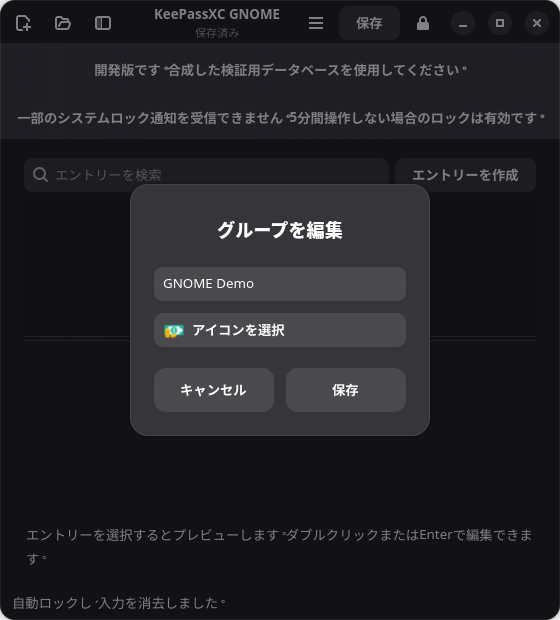

# グループの名前・アイコン編集とKDBX互換性

2026-11-14。利用者の依頼により、グループの名前変更と別画面だったアイコン選択を「グループを編集」へ統合した。新規依存と上流参照checkoutへの変更は無い。

## アイコンを読み込んだ場合と保存した場合

- 標準IconID 0〜68は番号に対応する画像を表示する。GTKへ組み込む69画像が、固定上流2.8.0の `share/icons/icons.qrc:125` 以降に登録された各番号のSVGと全件バイト一致することを確認した（`cmake/Frontend.cmake:10`、`src/gnome/DatabaseIcons.h:12`）。本家の別バージョンや外観設定までピクセル単位で同じ表示と保証する意味ではない。
- 既存のカスタム画像は現状で汎用画像アイコン表示。元画像bytes・UUIDは保持する。テキストだけの編集やアイコン未選択で、標準アイコンへ黙って置換しない。カスタム画像の描画・取り込みを実装したという説明はしない。
- 新規エントリーで選んだ標準アイコンは「エントリーを保存」でモデルと暗号化復旧へ確定し、その後のDB全体の「保存」でKDBXへ記録する。無変更の本家readerで、番号と元アイコンを含む履歴を検証している（`prototype/CoreSession.cpp`、`tests/domain_tests.cpp`）。

## 操作

1. 左のツリーで対象グループを選ぶ。
2. 左上の鉛筆ボタン「グループを編集」を押す。
3. 名前欄と「アイコンを選択」で必要な変更を行い、「保存」を押す。
4. DB全体の「保存」を押す。グループ編集だけの保存を、元のKDBXへ書き込み済みと扱わない。

名前が空なら「保存」を無効にする。キャンセルは名前・アイコンの両方を変えない。カスタム画像を持つグループでは、別の標準アイコンを明示選択しない限り元の設定を保持する。従来の外観アイコンの別ボタンは外し、編集操作へ統合した（`src/main.cpp:223`、`:950`）。

## 実装と復旧

`CoreSession::updateGroup(id, name, icon)` を追加した。-1はアイコン変更なし。名前・番号・対象の存在を全て検査した後に上流Groupのsetterを呼ぶ。一方の入力が不正なら、どちらの変更も行わない。`RemoteSession` / workerの単一のmutationとして扱い、一組の変更を暗号化復旧コピーへ保護してから成功応答を返す。プロトコルは4へ更新し、本体とworkerは同じ版を使う（`prototype/CoreSession.h`、`prototype/CoreSession.cpp`、`src/gnome/RemoteSession.cpp`、`src/gnome/session_worker.cpp`、`src/gnome/SessionProtocol.h`）。

グループ名欄は日本語・英語のaccessible nameを持ち、既存の専用文字バッファ・undo無効化を使用する。保存・キャンセルのresponseで入力をクリアする。AdwAlertDialogのclosed通知はresponseより先になる場合があるため、closed側で保存前の値を消さない。自動ロックは既存のフォーム消去・世代検査を使う。

## 確認済み

- 通常CTest22/22。Core / IPC両方で同時編集、入力不正時の無変更、保存再解除、本家reader、カスタム画像保持、明示選択による標準への変更を確認。
- 保護付きグループ編集の暗号化復旧に名前・アイコンが一緒に残り、不正編集では直前の復旧記録を変更しない。ASan / LSanの非GUI寿命検査107チェック成功。
- 日本語の製品GUIで実際に子グループを選択し、名前とアイコン66の変更、空欄の保存禁止、アイコン19を選んでキャンセルする操作を確認。ルートを誤って変更しないことも確認。

日英polish各59チェック、GUI寿命と日本語Orca31チェック、最終GUIのASanアクセス検査も成功した。通常ログインのdocument portalマウントは分離試験前後で維持した。

## dev7候補とVM

`build/dist/group-edit-candidate/` にdev7-1、`upgrade/` に更新試験用dev7-2を固定した。本体・worker・pickerのhashは両版で同一。dev6成果物は上書きしていない。

| 成果物 | SHA-256 |
| --- | --- |
| `keepassxc-gnome-development_0.1.0~dev7-1_amd64.deb` | `67ddc31e2607900515218cf44c7e7d552de6bde546533a79ee031608b5ee19aa` |
| `keepassxc-gnome-development_0.1.0~dev7-1.source.tar.xz` | `ffb08ec980b04a342f93c4d2e5c9c990efd6b1d57896617ecf33d5c7cedc41c4` |
| `keepassxc-gnome-development_0.1.0~dev7-1_amd64.manifest.json` | `5ef620bb156f77040643bfa192797b8c4fd5b4b61bf99e8a2ab5edb4863756e4` |

strip後の本体は `1812af6e967e2b62e34dc56773ee372e1ab87865b1b62b2debb43dcade1c040f`、workerは `b6567b7d8f98c517fbb3dacf94c309c36abc96669c57365c3b89e21640f2e237`、pickerは `cc9b74490cbc44e521a61dd74edf2f920ac5c6f6dfffb80548088052b58b83fd`。対応ソースは基点a8e44b2後の未commit差分を含む完全なスナップショットで、結果文書の後からの追記はアーカイブへ書き戻さない。

梱包・ハードニング・配置先worker / picker・locale・出典・改変拒否・Gitなし対応ソースのconfigure検査が成功。完全ソースからのフル再ビルドと同一入力の梱包再現は本候補では再実施していない。改修前RC1の結果を代用しない。

Ubuntu 26.04.1 VMに `keepass-gnome-before-dev7-20261114` を作成し、APT計画で開発アプリ1件だけと確認した。導入・更新・purge、合成設定の保持、再導入した `/usr/bin/keepassxc-gnome` の子グループの名前・アイコン同時編集とキャンセル、日英guard、配置先workerの寿命107チェックが成功した。最後に検証アプリを削除し、全パッケージ名・版・状態が開始前と一致した。guest agent経由で通常shutdownし、VMのshut offを確認した。新規依存・他のパッケージの更新や削除・snapshot復元は無い。

ログは `.cache/group-edit-{build,ctest,smoke,polish-ja-final,polish-en-final,lifetime-final,orca-ja,asan-lifetime,asan-polish-final,package-test}.log`、`.cache/vm-dev7-{transfer,plan,package-result,gui-result,cleanup}.log`、`.cache/vm-dev7-state.json`、`.cache/vm-dev7-logs/`。VM内は `/tmp/keepass-gnome-dev7.nk33K0/`。日英Orcaの両言語で新しいグループ編集フォームを聴取したという結果ではなく、日本語の既存Orca回帰と日英フォーム検査を区別する。

## 実機反映

利用者が必要な変更を保存して閉じ、今すぐ更新できると回答した後、開発版のプロセスが無いことと、APT計画が開発アプリ1件だけの更新であることを確認した。OS認証経由で `0.1.0~dev6-1` から `0.1.0~dev7-1` へ更新し、実行ファイル3件のhashを候補と照合した。他の全APTパッケージと本家Flatpak commitは不変。追加依存は無い。

合成専用の新しい `build/host-ui-dev7/` のstate / cache / dataと日本語環境で起動を要求した。対象PIDのAT-SPI照会ではロック画面のSHOWING状態と最上位フレームの照合結果を得られず、実機の画面表示・操作の自動確認は未完了とした。既存DBは開いていない。配置された日本語カタログの「グループを編集」「グループ名」は照合した。記録は `.cache/dev7-host/{install.log,result.json,launch.json,app.log,packages.before,packages.after}`、計画は `.cache/group-edit-host-plan.log`。

グループ編集の実際の操作検証は分離環境とVMで行った。実機では更新・hash・日本語カタログと起動要求を確認し、実際の表示・操作は利用者自身の確認を待つ。通常portalのマウントも維持されている。初回試験の同名変数によるビルド停止と、closed側で入力を早く消したGUI失敗、入力直後の描画snapshot失敗はログを保持して修正した。実際のDBは使用しない。GitHub公開は利用者自身の確認後の改めての明示指示を待つ。
