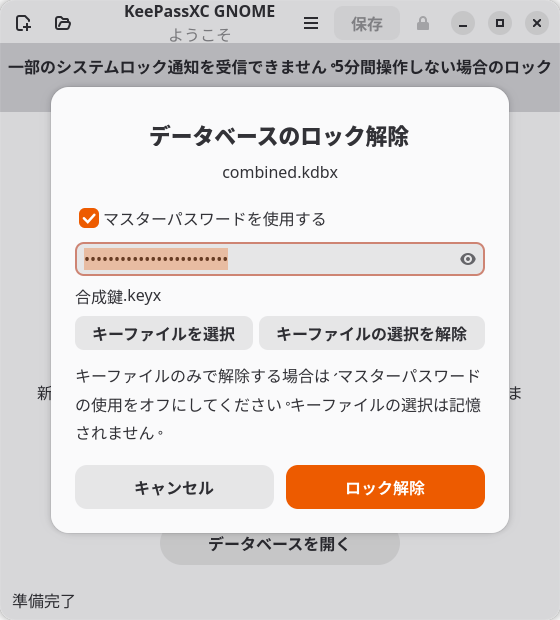
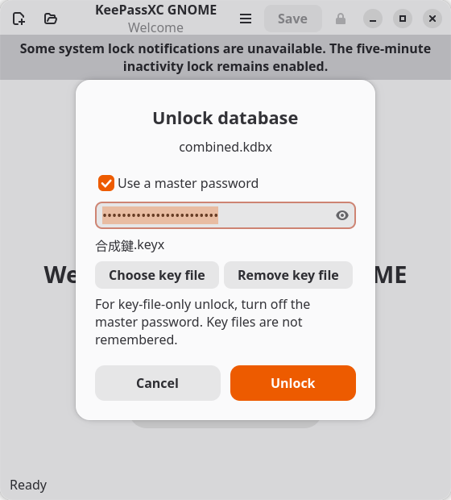

# キーファイルでの解除（2026-11-18、開発中）

利用者のロードマップ着手指示と構成の確認に基づく。既存DBをキーファイル単独、またはマスターパスワードとキーファイルの併用で解除する。パスワードだけの既存操作も維持する。新規DBの鍵設定、既存DBの鍵変更、キーファイル生成は今回の対象に含めない。

## 画面と操作

既存DBの解除画面に「マスターパスワードを使用する」とキーファイルの選択・選択解除を追加した。

- パスワードだけ：従来どおり入力して解除する。
- パスワード＋キーファイル：チェックをオンのままパスワードを入力し、キーファイルを選ぶ。
- キーファイルだけ：チェックをオフにしてキーファイルを選ぶ。不要になったパスワード入力は消去する。
- パスワードを使う設定のまま空欄でキーファイルを選ぶ場合は、「空のパスワード＋キーファイル」の鍵構成になる。パスワード因子の不在とは区別する。

少なくとも一つの因子が必要。キーファイルの選択中は解除を無効にする。選択画面をキャンセルした場合は直前の選択を維持し、明示的な選択解除で外す。解除のたびに新しいフォームを作り、パスワード・キーファイルの選択を復元しない。直近DBの記録にキーファイルは追加しない。日本語・英語に対応する。

GNOMEのネイティブ選択画面に `.keyx` / `.key` と全ファイルのフィルターを用意する。拡張子だけで鍵形式を決めない。ロックやフォームのキャンセル時は選択要求を取り消し、選択名・入力を消去する。遅れて届く選択結果は破棄する。

キーファイルを紛失したり内容を変更すると、元のDBや復旧ファイルを解除できなくなる。キーファイルはDBとは別に安全に保管する。

## 既存コアの利用と境界

- `prototype/CoreSession.h`：`UnlockCredentials` がパスワード因子の有無、値、キーファイルのパスを表す。既存のパスワード用APIは維持する。
- `prototype/CoreSession.cpp`：`PasswordKey` と `FileKey` を `CompositeKey` に追加して、既存の `KeePass2Reader` へ渡す。保存・別名保存・コピー・暗号化チェックポイントも同じコア鍵を使う。
- `src/gnome/KeyFile.h`：worker内で通常ファイルだけを非ブロッキングで開き、一度だけ有界スナップショットを作る。入力上限は16 MiB。ディレクトリ、FIFO、読み取れないファイル、読み取り中にサイズや時刻等が変わったファイル、NULを含むパスは拒否する。空・不正・未対応・チェックサム不一致は本家の結果に従って拒否する。上限超過と読取失敗は専用の文言で説明する。
- `src/gnome/RemoteSession.cpp` / `src/gnome/session_worker.cpp` / `src/gnome/SessionProtocol.h`：因子の指定とパスを私有socketで転送する。パスワードやキーファイルの内容をargv・環境変数へ追加しない。内部プロトコルは5へ更新し、古いworkerとの誤接続を拒否する。
- `src/main.cpp`：認証情報をresponseで確定してからフォームを消去する。選択要求の完了はフォームの生存状態・Windowの寿命・generationを確認する。
- `src/gnome/NativePicker.{h,cpp}` / `src/gnome/native_picker_worker.cpp`：既存のWayland親子関係と選択結果の検証をキーファイル用のフィルターへ拡張する。pickerは鍵の内容を読み取らない。

形式の解釈・鍵の導出・暗号・KDBXは独自実装しない。根拠は、固定した未改変の `upstream/keepassxc/src/keys/FileKey.{h,cpp}`、`keys/CompositeKey.cpp`、`keys/PasswordKey.cpp` と `tests/TestKeys.cpp`。XML v1/v2、32 byteバイナリ、64桁hex、任意ファイルのハッシュ形式はこの `FileKey::load(QIODevice*)` を使う。XMLから通常ファイルへのfallbackも本家の判定に従い、パスワードだけへのfallbackは行わない。

鍵の内容はGUIやpickerに渡さず、workerの入力用バッファは読み取り後に明示消去する。導出済みのFileKeyは本家のsecure_vectorに保持され、ロック時にはworkerを終了する。アプリ所有の認証値・選択パスは消去するが、toolkitやOS等の全メモリの完全消去を主張するものではない。解除処理はキーファイルやDBの原本に書き込まない。

## 検証

`tests/keyfile_reference.cpp` はCoreOverridesを適用しない独立した本家コアにリンクする。合成DBを生成し、本アプリが保存した結果を再読込して、同じ因子で解除できること、属性・保護・添付・TOTP・履歴が保たれることを照合する。

`tests/keyfile_tests.cpp` は5形式×KDBX3.1/4.0/4.1×因子3通りの45組を、直接コアと実workerの両方で確認する。コピー保存・通常上書き・別名保存・暗号化復旧を独立コアで検証し、解除後にキーファイルを取り外しても保存できることも確認する。誤ったパスワード・鍵、鍵不足、空と不在のパスワード、破損checksum、未対応XML版、空ファイル、16 MiB超過、FIFO、ディレクトリ、権限不足、NULパス、試験用の小さい上限を扱う。

`tests/keyfile_ui_probe.cpp` / `tests/ui_keyfile.py` は製品Windowを別実行ファイルで使い、私有GNOME/Waylandで実Return/KP_Enter、選択・キャンセル・削除、誤認証後の非公開、ロック時の選択要求取消と入力消去、毎回の未選択を検証する。実際の利用者の画面・DB・キーファイルは使用しない。

```bash
source tools/dev-env.sh
cmake -S . -B build -G Ninja -DKPXC_GNOME_DEVELOPMENT_UI=OFF
cmake --build build --parallel 4
dbus-run-session -- ctest --test-dir build --output-on-failure
bash tools/test-ui.sh --keyfile
KPXC_UI_LANGUAGE=en bash tools/test-ui.sh --keyfile
bash tools/test-reader-memory.sh --keyfile-ui
```

## 結果

- 通常CTest 24/24が成功。キーファイルの45組を直接コアと隔離workerの両方で確認し、独立コアで保存・上書き・別名保存・復旧の再解除と既存データ保持を照合した。
- 日英のGUIが成功（日本語104、英語106チェック、poll回数で一部変動）。実Return / KP_Enter、併用・単独解除、キャンセル・削除・誤認証・履歴保全・ロック中の選択要求取消・保持した古いフォームの入力消去を確認した。
- 既存の日本語公開歓迎101チェックと、パスワードDB作成・編集・メモ改行・終了時保存の実Return回帰が成功。
- 最終ビルドで既存GUIの秘密寿命・自動ロック・入力消去・clipboard失効・復旧の再認証と、従来のパスワード欄からの実Return解除も成功。`tools/check-release.sh`へ日英キーファイルGUIとASan版を接続した。
- キーファイルの直接コア・異常入力・保存検査はASan/LSan（detect_leaks=1）で成功。新しい解除GUIのASanアクセス検査も成功（GUIはdetect_leaks=0）。既存のGUI全体の生LSan非ゼロ・長時間のメモリ増加は解決扱いにしない。
- 日英とも幅560の実描画を目視確認し、項目名・選択操作・説明・解除ボタンが収まることを確認した。`git diff --check`も成功。

初期のGUI検証で、AlertDialogの終了時点で入力を消すとresponseによる確定前に消去される問題を検出した。responseの通常ハンドラーで確定した後、afterハンドラーでフォームを消去する構成へ修正し、既存パスワード解除と新しい実キー検査の両方を通した。キー送信試験はアクティブ化後のフォーカスをAT-SPIで確認し、実際のキーを送る。activateシグナルの直接発火をEnterの代用にしていない。

ログ：`build/keyfile-{final-build,ctest-final,domain-test,domain-asan,ui-ja,ui-en,ui-asan,welcome-regression,default-keys-regression,lifetime-regression,unlock-regression}.log`、`build/ui-keyfile-{ja,en,ja-asan}/`。私有GNOMEには従来のportal設定・monitorのAccessDeniedが出るが、各シナリオは完了した。

ソースとローカルビルドへ反映済み。T16のインストール更新・debのVM導入・新たなリリース・Git commit/pushは未実施。実機での最終的な見え方・IMEの変換中操作は未確認。上流参照・新規依存・実DB・本家のインストールへの変更はない。

## 合成データの画面例




