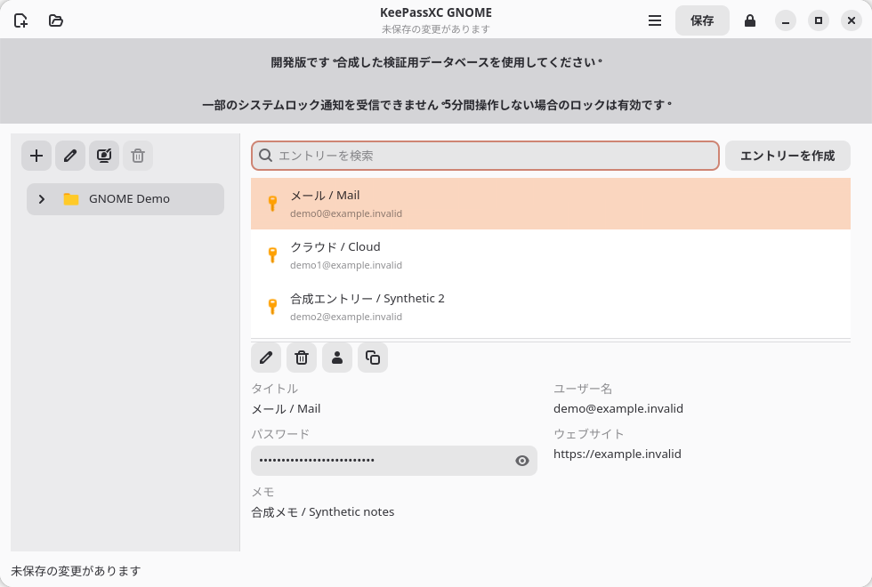

# グループツリー・アイコン選択・エントリープレビュー

追記：dev6で分かれていたグループの名前・アイコン変更は、[dev7のグループ編集](group-icon-editing.md)で同じ編集画面へ統合した。以下は主にdev6時点の構成・検証記録。

2026-11-14。利用者指定の本家KeePassXCに倣う構成へ変更した。製品ソースの変更と合成データの分離GUI検証を実施。既存の本家インストール・本番DB・上流参照checkoutは変更していない。改修前のdev5・RC1は従来の記録として維持する。その後[dev6のdeb・VM検証と実機更新](navigation-preview-candidate-validation.md)を完了し、日本語ロック画面での起動を確認した。新UIの実機操作は利用者自身の確認を待つ。

## 画面と操作

- **左：グループツリー。** 名前の前にアイコンとGTK標準の開閉矢印を表示する。解除直後は全グループを閉じ、クリックで展開する。子を作成した場合は作成先を開いて見えるようにする。同じ解除セッションでの更新時は開閉を維持し、ロック後の再解除で閉じる。KDBX内の元の展開設定を書き換えない（`src/gnome/NavigationList.h`、`src/main.cpp:229`、`:869`）。
- **右上：エントリー一覧。** 選択グループ直下のエントリーを表示する。検索文字列がある場合は従来どおりそのグループを起点に上流検索を行う。タイトルの前にアイコン、下にユーザー名を表示する（`prototype/CoreSession.cpp:277`、`src/main.cpp:269`）。
- **右下：読取専用プレビュー。** タイトル、ユーザー名、パスワード、URL、メモ。パスワードは選択し直すたびに伏せ字へ戻る。プレビュー上端の左側に編集・削除・ユーザー名コピー・パスワードコピーを置く。既存の削除確認・clipboardの注意と期限を再利用する（`src/main.cpp:283`、`:920`）。
- 一覧の単一クリックは選択・プレビュー、ダブルクリックまたはEnterは編集。Tabで一覧へ入り、上下キーで選択できる。右の上下境界はドラッグでき、長いメモはスクロールする。狭幅は従来のグループサイドバー切り替えを維持する（`src/gnome/SummaryList.h`）。

[ダーク画面](images/navigation-preview-dark.png)。これは私有GNOME上の実際のGTK画面。監視サービスがない私有セッションの警告も実表示のまま残し、通常ログインの正常状態の画面と混同しない。

## アイコンと保存互換性

標準IconID 0〜68の69種類を、固定した上流 `share/icons/database/` のSVGから変更せずGResourceへ組み込む。新規グループはフォルダー48、新規エントリーは鍵0。グループのツールバー「グループのアイコン」と、エントリー編集画面の「アイコンを選択」から選ぶ。既存のPNG等の新規取り込み機能は含まない（`cmake/Frontend.cmake:10`、`src/gnome/DatabaseIcons.h`）。

**既存カスタムアイコンは画像・UUIDを保存時に保持するが、今回のGTK表示は汎用画像アイコンである。** この表示上の制限を保存時の置換と混同しない。別の標準アイコンを明示的に選択した場合だけ、上流の `setIcon(int)` によって切り替える。選択なし・キャンセル・テキストだけの編集ではカスタムアイコンを置き換えない。将来IDも汎用表示とし、GUIの未選択値-1で元のアイコンを維持する。

`EntryDetails` の未選択値-1、標準番号・カスタム有無をIPCへ追加した。プロトコルは3。本体とworkerは同じ版の一組で扱う。グループのアイコン変更も既存の保護付きmutation経路へ含め、暗号化復旧コピーが保護される。暗号処理・reader / writerは再実装しない（`prototype/CoreSession.h`、`prototype/CoreSession.cpp:350`、`:395`、`src/gnome/SessionProtocol.h:18`、`src/gnome/session_worker.cpp`）。上流の著作権・アイコンのCC0 / MIT等の表示は既存の完全なCOPYING・ライセンス同梱を継続する。

## 寿命・非同期処理

プレビューの応答は選択ID・要求番号・解除世代を確認してから適用する。選択変更・検索結果の更新・ロック時は文字とパスワードバッファを消し、遅い応答で復活させない。秘密欄のundoを無効にし、専用バッファを再利用する。支援技術による選択・編集でも無操作期限を確認し、期限切れを迂回しない（`src/main.cpp:920`、`:1027`）。

仮想リストにはGTKの通常Box / Label / Imageを使う。旧実装のGtkListBox用AdwActionRowをGtkListViewに入れる構成はTabで `gtk_list_box_row_grab_focus` の失敗を起こし得たため置き換えた。ラベルはmarkupとして解釈しない。行の再利用・モデル破棄では文字・画像・アクセシビリティ名をクリアする。GtkTreeListRow.get_itemの返す参照も解放する。[GTKの所有権契約](https://docs.gtk.org/gtk4/method.TreeListRow.get_item.html)と[TreeExpanderの使用方法](https://docs.gtk.org/gtk4/class.TreeExpander.html)を確認した。

## 検証結果

| 検査 | 確認した結果 |
| --- | --- |
| 通常CTest | 22/22成功。Core / IPC両方で標準アイコンの既定値・境界拒否・保存再解除・本家readerでの番号と履歴を確認 |
| カスタムアイコンの保持 | Core / IPC両方でテキスト編集後の画像bytes・UUID・グループ・元画像の保持、および明示的な標準への変更が成功 |
| 日本語の製品GUI | 作成・アイコン19選択・プレビュー・編集・検索・グループの1クリック開閉・アイコン66選択・ロックが成功 |
| 寿命GUI | 選択からの非同期プレビュー、編集・ロックでの欄消去、保護した復旧、元ファイル不変、Window / Applicationの破棄が成功 |
| 日英polish | 各48チェック成功。初期閉・展開と再閉・2万件の行再利用・狭幅・明暗追従・プレビュー消去・picker寿命を含む |
| 実Orcaの私有セッション | 日英各31チェック成功。伏せ字プレビューの英字非発話、一覧へTabで移動して実Enterで編集できることも追加 |
| ASan | GUI寿命検査と、最終の通常行構成のpolishが成功。アクセス違反の検査であり、生LSanゼロの判定ではない |
| 通常ログインのportal | 分離GUI試験前後で `/run/user/1000/doc fuse.portal` のマウントを維持 |

ログは `.cache/ui-navigation-{ctest-fixed,smoke-final,lifetime-final,polish-ja-final,polish-en-final,orca-ja,orca-en,asan-lifetime,asan-polish-final,save}.log`、各 `build/ui-*/`。新規依存導入はない。最初の通常sandboxでのbus socket拒否によるtimeout、入力不正をprotocolの致命エラーにしてしまった経路、メニューボタンの内部要素、非同期プレビュー待ち、Tab到達性の失敗は経緯として残し、修正して上表を確認した。

## 未完了・制限

カスタム画像そのものの描画と取り込みは今回未実装。既知の長時間メモリ増加・生LSan非ゼロ・外部clipboard残留の評価は維持する。GUI改修後の実機では更新・版とhash・日本語ロック画面までを確認した。新UIの一通りの実機操作は未実施であり、改修前のdev5実機結果を新UIの実機操作合格に読み替えない。公開は利用者自身の確認後の改めての明示指示を待つ。

作業中に報告された本家Flatpakの起動失敗は[別の調査記録](original-keepassxc-startup-2026-11-14.md)。利用者承認後のdocument portal再起動で本家GUIは復旧したが、マウント消失の根本原因と本プロジェクトとの因果関係は未特定。
