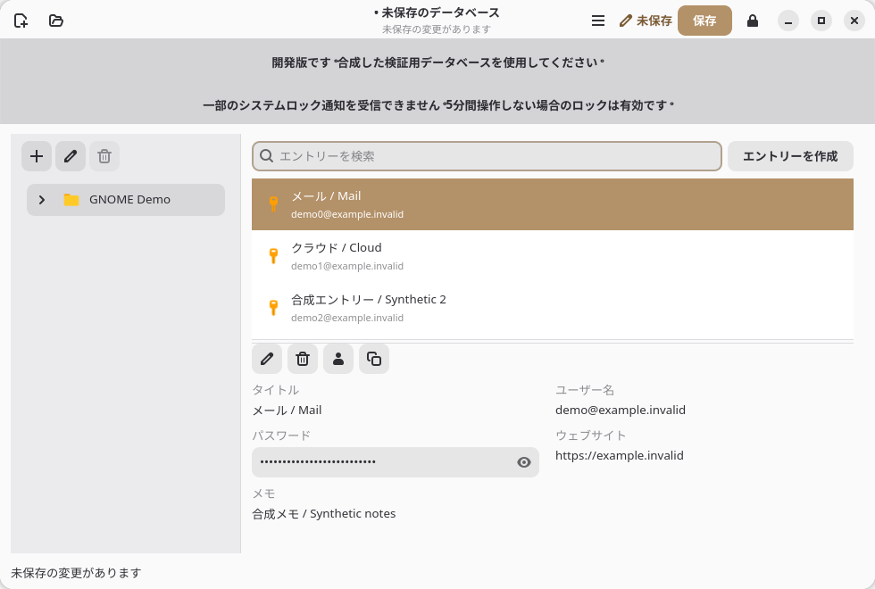
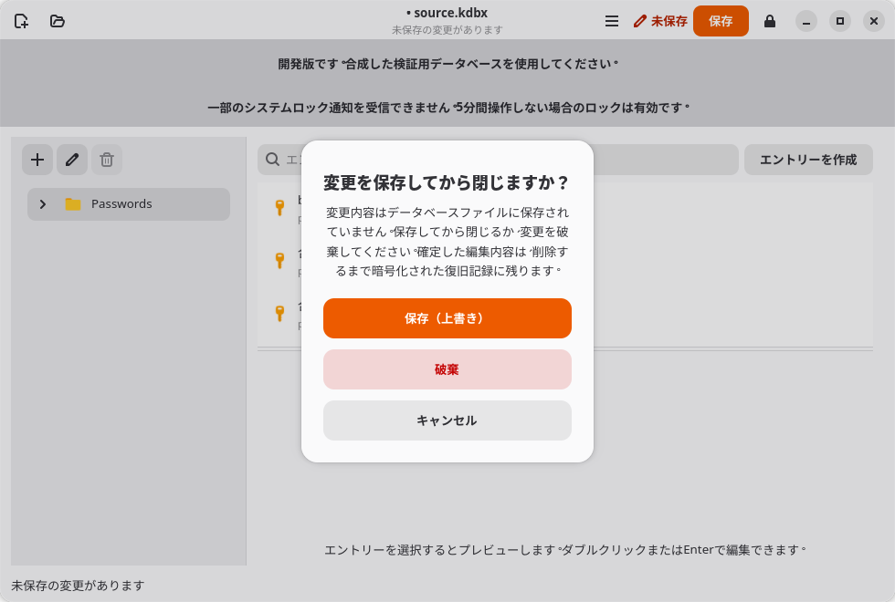

# 未保存表示・終了時の保存・アクセントカラー

2026-11-14。利用者の3点のUI修正依頼に対応する。KDBX・暗号・上流checkout・workerの仕様は変更しない。

## 実装した動作

### 未保存の変更

エントリー・グループの編集を確定してDBファイルへまだ保存していない間、ヘッダーに鉛筆アイコンと「未保存」を表示し、ファイル名に「•」を付け、保存ボタンをGNOMEのアクセント色で強調する。字幕の「未保存の変更があります」も維持する。コピーや検索等の一時的なメッセージで印が消えず、色だけに依存しない。正常な関連保存で印を消す。コピー保存や保存失敗では消さない。ロック時には現在のDB名・モデルとともに印を消す。OSのウィンドウタイトルにもbasenameと印を反映する。未保存の新規DB・復旧コピーのヘッダーは「未保存のデータベース」とする。

根拠：`src/main.cpp:157` の `dirtyIndicator`、`sensitivity` / `updateTitle`、`saveDatabase` / `conceal`。

### 終了時の保存

未保存の確定変更があるとき、ウィンドウの終了確認は「キャンセル」「破棄」「保存（上書き）」の3択になる。通常の関連先を持たない新規DB・復旧コピーでは「名前を付けて保存…」とし、既存のnative chooserと関連保存を使う。

- 保存は既存のSafeSave経路を使用する。関連先への書込・読戻し・置換・durabilityが成功した `SaveResult::committed()` の後だけ、終了の続きへ進む。
- 選択のキャンセル・chooserの失敗・外部更新との競合・通常の保存失敗応答は、理由を表示してウィンドウと未保存モデルを保持する。workerの異常終了等では従来どおりロックし、確認済みの編集は暗号化復旧記録から取り出す。異常終了を保存成功と扱わず、アプリも自動で閉じない。既存ファイルへの強制上書きや、失敗後の終了は行わない。
- 保存待ちの再度の終了要求は重複処理を開始しない。別の編集・検索等を待機中に始めず、保存対象が変わらないようにする。自動ロックは優先し、世代を変えて未完了の終了処理を無効にする。ロック後に古い保存応答でアプリを閉じない。
- 編集画面内の未確定入力を、DBの保存だけで保存済みと扱わない。先に編集を確定するかキャンセルする。GTKの通常動作で編集ダイアログだけを閉じた場合、入力は従来どおり消去される。
- 保存・変更処理が進行中なら完了を待つよう案内する。読み込みだけの途中の終了は、従来どおり即座に中断・秘匿化できる。
- 破棄は明示選択の場合だけ。暗号化復旧記録が残ることを確認文に記載する。Escapeはキャンセル、既定応答は保存とする。

根拠：`src/main.cpp:690` `requestClose`、`chooseFileImpl` の保存継続、`src/main.cpp:926` `saveDatabase`、`submit` の世代・transport失敗処理。元の保存処理の根拠は `prototype/SaveTypes.h` / `src/gnome/SafeSave.cpp`。汎用のロック・DB切替時の破棄確認とは別に終了確認を実装し、既存の安全な保存経路を共有する。

### GNOMEのアクセントカラー

主要な保存・作成・解除ボタンにはlibadwaitaの標準スタイルを使い、エントリーの選択行にもアクセントを使う。選択行の文字は対応する前景色を使い、ユーザー名を選択中に薄くしない。グループのnavigation sidebarはGNOME標準の選択スタイルを保つ。危険な確定操作には標準のdestructive応答を使う。

libadwaitaがシステムの色を取得できる場合はその値に従う。ダンプ保護によってportalがアプリを識別できず取得できない場合は、GNOMEの `org.gnome.desktop.interface` の `accent-color` を読み取り専用で参照する。設定変更と明暗の変更に追従する。色はlibadwaitaのenum・パレット関数から取得し、青等に固定した独自パレットは作らない。

補完CSSは本アプリのウィンドウに限定し、他アプリやデスクトップ設定を変更しない。高コントラストの通知中は独自の選択色・補完CSSを外し、toolkitの標準規則へ戻す。CSS provider・signal・参照はWindowの寿命に合わせて解放する。高コントラストモード自体の新しい実機受入は今回未実施。

根拠：`src/gnome/Appearance.h`、`src/gnome/SummaryList.h` の `kpxc-entry-list`、`src/main.cpp` の保存ボタンの標準style class。libadwaitaの必要SDK版は1.6以上と明記した。対象Ubuntu 26.04の既存1.9.1を使い、新規依存は導入しない。[公式の色設定](https://gnome.pages.gitlab.gnome.org/libadwaita/doc/1-latest/styles-and-appearance.html)、[CSS変数](https://gnome.pages.gitlab.gnome.org/libadwaita/doc/main/css-variables.html)、[StyleManager](https://gnome.pages.gitlab.gnome.org/libadwaita/doc/main/class.StyleManager.html)。

## 確認結果

- 通常CTest 23/23。既存の保存復旧・GUI寿命・読込中の中断と終了・guard・実Return解除・歓迎画面・日本語基本操作が成功。
- `tools/test-ui.sh --close` の日英シナリオが成功（実行時169 / 171チェック）。正常な上書き終了、キャンセル、初回保存の取消・失敗・成功、外部競合での保持、明示破棄、未確定フォーム、重複終了、ロックによる終了継続の無効化を確認した。再度開いた合成ファイルから確定編集を照合する。chooserは別の私有busの模擬portalで、workerの暗号化保存は実処理を使う。
- `tools/test-ui.sh --polish` の日英各322チェックが成功。GNOMEの10色をメモリ内の私有設定で切り替え、ライト・ダーク両方で保存ボタンと選択行の**実ピクセル**をlibadwaitaのパレット値と照合した。文字色、仮想リスト、狭い画面、既存のtheme / picker動作も確認した。
- `tools/test-reader-memory.sh --close-ui` と `--polish-ui` のASanアクセス検査が成功。GUIはdetect_leaks=0であり、既存のGUI全体の生LSan非ゼロ・長時間メモリ基準未達を合格へ変更しない。
- 最初の一部試験は実機の13:42:56〜13:48:37のスリープ（`systemd-suspend.service`の記録）と重なって中断した。復帰によりモデル状態が変わった実行を成功扱いせず、復帰後に個別実行して終了0を確認した。通常環境のスリープ設定は変更していない。
- 診断用の広いプロセス一覧の実行は自動承認が期限切れとなり実行されなかった。対象を既知の私有GUIに限定した読み取り専用診断で再試行し、残留なしを確認した。通常プロセスの終了・保護の緩和は行わない。

ログは `build/close-*.log` / `build/close-accent-*.log`。共通入口 `tools/check-release.sh` に日英の終了時保存とASan検査を追加した。実機の既存DBには触れず、使用データは合成のみ。

新候補の梱包とVM→実機の結果は以下へ追記する。新しい実機操作の受入、全ソースからの再コンパイル、GUI全体のLSanゼロ、高コントラストの新しい実機確認を、このローカル成功だけで確認済みと扱わない。GitHub公開は利用者の別途指示を待つ。

## 画面例

合成データ・私有GNOMEで撮った実描画。通常実機のDBや設定を撮影したものではない。上部の監視警告は一部サービスが無い試験条件による。選択色の例はメモリ内で切り替えた色であり、利用者の設定を変更していない。

## dev10候補・VM・実機

成果物は `build/dist/unsaved-close-accent-candidate/`。既存dev9等を上書きしていない。

| 成果物 | SHA-256 |
| --- | --- |
| `keepassxc-gnome-development_0.1.0~dev10-1_amd64.deb` | `44c058d91a2d7405f70e2865a3e2c09ba53cadc0a99e11f11e0ee09f26f74a7c` |
| `keepassxc-gnome-development_0.1.0~dev10-1.source.tar.xz` | `3f6a829ad1304c7b7159cb6c06e0b048c9c9f542a188a1eff2899306b4702334` |
| `keepassxc-gnome-development_0.1.0~dev10-1_amd64.manifest.json` | `83af723cbee86eb3ac91d32fdb6bcae4ccd75d67cf0cd44ded0f49b1c77503c5` |

| 実行ファイル | strip後のSHA-256 |
| --- | --- |
| `keepassxc-gnome` | `da709be5bb896c82fe65efd9d0870c73f1ae428f6234d60e0be53191cb5827e8` |
| `keepassxc-gnome-worker` | `b6567b7d8f98c517fbb3dacf94c309c36abc96669c57365c3b89e21640f2e237` |
| `keepassxc-gnome-picker` | `cc9b74490cbc44e521a61dd74edf2f920ac5c6f6dfffb80548088052b58b83fd` |

worker / pickerはdev9と同一。更新試験用dev10-2の3実行ファイルも同一。基点commitは `a8e44b219156a54836661f6e3d620b26ebdb6af4`、以降の未commit変更を含む。対応ソース全体のhashで候補を識別する。本家参照は2.8.0 / `1c2f23ef5914c0f442a00533def1689857afb5a7` で不変。

梱包・配置先worker / picker・locale・ハードニング・出典・上流改変拒否・Gitなし対応ソースのconfigureが成功。この候補で全ソースからのフル再コンパイルと梱包再現は再実施していない。

停止中のUbuntu 26.04 VMに `keepass-gnome-before-dev10-20261114` を追加し、`/tmp/keepass-gnome-dev10.naVA1y/` でhashを照合した。導入・dev10-2へ更新・purgeとsentinel保持、配置先workerの合成CRUDが成功。再導入して3実行ファイルを照合した。

最初のGUI検査は、選択後のモデル更新で以前のAT-SPI行参照を保持した既存のグループ選択確認で停止した。検査スクリプトを、現在の行を名前で再取得しcacheをクリアして選択状態を読む方法に修正した。選択状態の確認を削除せず、直後の編集フォームが対象の子グループ名で開くという確認も維持した。ローカルとVMで同じ条件が成功。**この調整で製品コードを変えていない**。固定済みのsource archiveを上書きせず、実際に使った検査の差分を `qa/ui-smoke-live-selection.patch`、前後のscriptとarchiveのhashを `qa/manifest.json` に保存した。本節・画像等も候補固定後の記録として扱う。

VMの再検査では、配置先製品の日本語基本操作・子グループ選択／編集対象、日英の終了時保存（172 / 169）、10色×明暗のpolish323、歓迎・履歴、日英のファイル起動／関連付け・guard、履歴26、寿命107が成功した。VMのlibadwaitaは既存の1.9.1-0ubuntu0.1、ビルドSDKは1.9.1-0ubuntu0.2。追加依存は無い。最後に検証アプリだけをpurgeし、全パッケージ名・版・状態は開始前とバイト一致（SHA-256 `59e45b2d14e4c0511b423105c87adae1d57e8cf650aaca213194564c27a73333`）。残存する配置先製品プロセスなし。guest agent経由で通常shutdownしshut offを確認した。snapshot復元・autoremoveは行わない。ログは `.cache/vm-dev10-logs/`、stateは `.cache/vm-dev10-state.json`。

実機更新は、利用者の保存・終了とOS認証の準備完了を受けて行った。最初は開発版がまだ稼働していたため導入を開始せず、利用者の再度の終了回答後に停止を確認した。dev9-1→dev10-1をOS認証で更新し、3実行ファイルと日本語の「未保存」「保存（上書き）」「変更を保存してから閉じますか？」を照合した。他の全APTパッケージ、本家Flatpak commit、明示MIME設定、ユーザー用の本家ランチャーと候補cacheは不変。今回cacheの再生成はしていない。更新後に開発版を日本語・通常のアプリ専用profileで起動した。DB引数・画面の照会・実DB操作は行っていない。

記録は `.cache/dev10-host/{result.json,install.log,launch.json,packages.before,packages.after,mime-metadata.before.json,mime-metadata.after.json}`。今回の変更点の実機操作・見え方の受入は利用者自身の[確認](manual-acceptance.md)を待つ。新しい依存・上流修正・GitHub公開・新しいcommit / pushは行わない。
