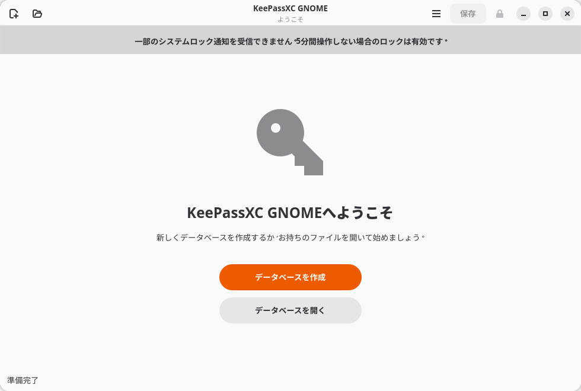
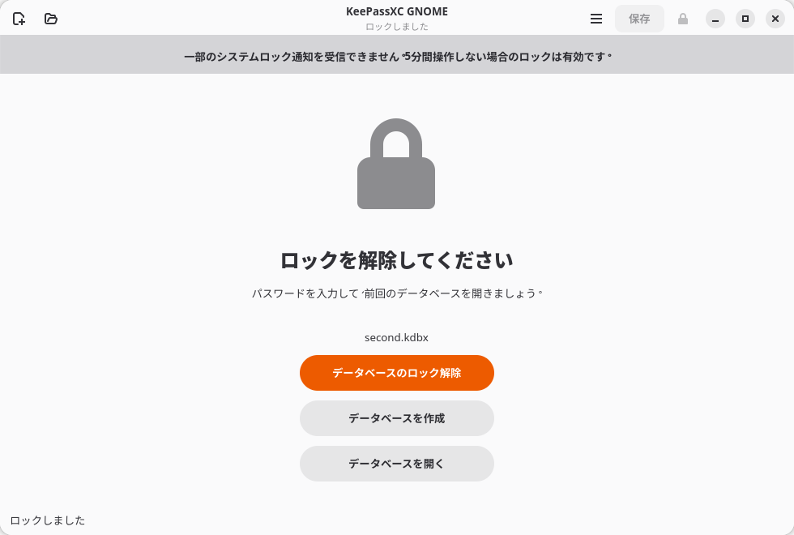

# 歓迎画面・直近1件の履歴・ファイル名・KDBXの関連付け

2026-11-14。利用者のUI修正依頼と追加指定を反映する。GitHub公開は利用者の別途の指示を待つ。

## 画面と履歴

- 初回は鍵のアイコン、「KeePassXC GNOMEへようこそ」、中央の「データベースを作成」「データベースを開く」を表示する。説明は利用者の指定どおり「新しくデータベースを作成するか、お持ちのファイルを開いて始めましょう。」。日英の環境自動選択を維持する。
- 最後に正常に解除した通常DB、または関連先として正常に保存したDBの**1件だけ**を記録する。固定の既定DB・お気に入り・複数件リストではない。失敗した解除・保存、コピーの保存、暗号化復旧コピーの解除は履歴を置き換えない。新規作成はファイルへ正常に保存するまで記録しない。
- 次回の起動は「ロックを解除してください」、直近のファイル名、中央の解除ボタンを表示する。新規作成・別ファイルを開くボタンも残す。起動時に読み出すのは履歴メタデータだけで、DB本体の読込・存在確認・解除はしない。解除ボタンは毎回、新しいパスワード入力を要求する。
- メニューの「最近のデータベースを履歴から削除」で履歴だけを削除できる。DB・暗号化復旧記録は削除しない。再起動後は歓迎画面へ戻る。その後に別のDBを正常に開く／関連保存すれば、その1件を新たに記録する。
- 解除中のファイル名は中央のヘッダーへ、保存状態とともに表示する。フルパスを通常画面に出さず、長い名前はGTK標準の省略を使う。名前はマークアップとして解釈しない。通常保存では維持し、成功した別名保存で切り替え、コピー保存や失敗時は変更しない。ロック時は現在の関連先を消し、履歴として許可された1件の名前だけを中央に案内する。

根拠：`src/main.cpp` の `Window` の歓迎操作、`updateTitle` / `displayFilename` / `credentials` / `saveDatabase` / `conceal`、`src/gnome/RecentDatabase.h`。暗号・KDBX・workerの仕様変更はない。

## 履歴メタデータの扱い

保存先は `$XDG_STATE_HOME/keepassxc-gnome/recent.ini`（未指定時は `~/.local/state/keepassxc-gnome/recent.ini`）。ローカルの絶対パスだけを保存し、パスワード・鍵・エントリー・DBの内容を含めない。本家KeePassXCの設定や既存履歴を読み込まない。この版で今後正常に開く／関連保存するファイルから記録を開始する。

ディレクトリは所有者のみの0700、ファイルは0600。読込は16KiB、パスは4096バイト以内。所有者・モード・通常ファイル・リンク数を検査し、symlink / hardlink / FIFO等を拒否する。private directory FDとopenat / O_NOFOLLOWを使い、一時ファイルのfsync・rename・directory fsyncで更新する。非ブロックflockで複数プロセスの変更を直列化する。壊れた／安全でないメタデータはDBへ影響させず、更新失敗を表示する。メタデータが壊れた場合の自動修復・強制削除は行わない。

ファイルの場所は秘密と同等に扱う必要がある場合もあるが、この履歴は暗号化された保管庫ではない。履歴削除は現行メタデータの削除であり、ファイルシステム・バックアップからの安全消去を保証するものではない。ロック画面には利用者の依頼に従って直近のbasenameが表示される。

## 公開向け文言

通常の歓迎・読込上限・保存完了・復旧コピーの日本語を製品向けに修正した。「検証用DBを作成」「この開発版の上限」「保存し、検証しました」は通常操作に使わない。保全や整合性確認自体は変更していない。

`KPXC_GNOME_DEVELOPMENT_UI=ON`（既定）では、現行開発版のタイトルと合成DB専用bannerを維持する。OFFではタイトル・banner・`--version`を公開向け表示にできる。別のテスト実行ファイルで公開向けUIを確認し、開発版の安全上の位置付けを隠して公開済みとは扱わない。公開用パッケージ名・desktop ID・連絡先・署名等の最終化は[公開設定](publication-settings.md)に従う別の公開準備であり、UIのOFFだけで完了しない。

## 本家と本アプリの関連付け

本家と同じ `application/x-keepass2` を宣言し、独立したdesktopファイルを選択候補にする。`.kdbx`のglob定義も独立名 `org.keepassxc.Gnome.Development.xml` で配置する。本家のdesktopファイル・MIME定義・プログラムは置換しない。`Exec=keepassxc-gnome %f`でローカルファイル1件を受け取り、`G_APPLICATION_HANDLES_OPEN`から通常の解除ダイアログへ接続する。起動直後はシステムロック保護の初期確認を待ち、保護が成立しなければ認証を開始しない。URI等の非ローカル入力や一つの起動への複数ファイルは理由を示して拒否する。引数はシェルに渡さない。

「ファイル」でKDBXを右クリックし「別のアプリで開く」から使用するアプリを選ぶ。既定を変える場合はファイルのプロパティの「開くアプリケーション」等から利用者自身が選ぶ。本アプリのメニュー「KDBXファイルの関連付け」にも案内を置く。操作の名称はGNOMEの翻訳で異なることがある。[GNOMEの公式手順](https://help.gnome.org/gnome-help/files-open.html)。

インストールするのは候補の宣言であり、`mimeapps.list`を配布せず、既定を書き換えるコマンドやAPIを使わない。**明示設定された既定を上書きしない**。ただし既定が未設定なら、候補登録後にOSがいずれかを自動選択することがある。「インストール前後のあらゆる未設定環境で実効既定が不変」とは保証しない。[Desktop Entry仕様](https://specifications.freedesktop.org/desktop-entry/latest-single/)、[MIME関連付け仕様](https://specifications.freedesktop.org/mime-apps/latest-single/)。既定の関連付けはDBごとではなく同じMIME型全体に適用される。複数起動時も、同じDBを本家と同時編集する運用を推奨するものではなく、既存の外部更新検知を維持する。

根拠：`packaging/org.keepassxc.Gnome.Development.desktop` / `.xml`、`packaging/Install.cmake`、`src/main.cpp` の `openFiles` と `main`。

## 検査と未完了

履歴の単体試験、日英・開発／公開表示のGUI、歓迎画面の狭い幅、保存・復旧・ロックの回帰、私有GNOME内でのdesktop経由ファイル引渡しを実施する。関連付け試験では本家の**模擬desktop**を私有XDG設定で既定にし、本アプリの候補追加後も設定が不変で、両候補が列挙されることを確認する。本家の実プログラムや実DBを起動・操作する試験ではない。

検査の確定結果・dev9候補・VM結果は本節に追記する。dev9の実機反映は完了した。利用者自身によるファイルマネージャーでの候補選択・今回の画面操作の受入は未実施。既存の長時間メモリ増加、カスタム画像の描画未実装等の制限は変更していない。

### ローカルで確認済み

- 通常CTest **23/23**。新しい履歴試験は26チェック（再起動、直近1件への置換、削除、競合lock、異常な長さ、symlink / hardlink、権限、破損入力等）。
- 開発向け歓迎GUIは日英各69チェック、公開向けは日英各100チェック。正常解除／失敗時の履歴、コピー保存／失敗した別名保存での関連先維持、成功した別名保存への切替、ロック、再生成したWindowからの解除、履歴削除、560px幅、保留したファイル起動の取消・終了時の破棄を確認。GTKの実描画画像を `build/ui-{welcome,public-welcome}-{ja,en}/` に保持する。私有バスでは一部の監視サービスが無いため、通常実機とは別の警告が表示される。
- desktopファイル経由の引渡しは日英とも成功。私有の本家模擬既定設定は候補追加・起動後もバイト一致、両候補が列挙され、UTF-8・空白・引用符・シェル風文字を含む合成ファイル名がそのまま渡る。毎回のパスワード入力、実worker解除、ロック、非ローカル／複数指定の拒否、原本hash不変を確認した。製品のダンプ保護を緩めず、GIOの起動contextが返したPIDに限定してGUIを操作する。
- 既存の保存・復旧、GUI寿命、日本語polish61、実Return解除、日本語guard、基本CRUD・検索・ロックの回帰が成功。
- 履歴メタデータのASan / LSan（detect_leaks=1）と歓迎GUIのASanアクセス検査69チェック（detect_leaks=0）が成功。**GUI全体の生LSan非ゼロを合格へ変更しない**。新しい手順は `tools/test-reader-memory.sh --welcome-ui`。
- `git diff --check`、desktop-file-validateが成功。通常ログインの `/run/user/1000/doc` の `fuse.portal` マウントは検査後も維持した。通常環境の関連付けは変更していない。

主な再実行コマンドは `tools/test-ui.sh --welcome` / `--public-welcome` / `--file-open`、英語は `KPXC_UI_LANGUAGE=en`。共通入口 `tools/check-release.sh` へ追加した。ログは `build/welcome-*.log` / `build/public-welcome-*.log`。

### 画面例とソース参照

以下は公開向け表示のテスト実行ファイルで撮ったGTKの実描画。上部のロック通知警告は私有バスに一部サービスが無い試験条件を示し、実機の状態を撮影したものではない。

| 主な判断・動作 | ソースの位置 |
| --- | --- |
| 中央の作成・開く・解除、履歴削除 | `src/main.cpp:190`, `src/main.cpp:214` |
| 歓迎／直近の区別とファイル名表示 | `src/main.cpp:552` |
| 元のパスと表示名の区別、マークアップ非解釈 | `src/main.cpp:570` |
| 成功した通常解除だけを関連先・履歴にする | `src/main.cpp:814` |
| 成功した関連保存だけでファイル名を切り替える | `src/main.cpp:868` |
| bounded・private・atomicな履歴メタデータ | `src/gnome/RecentDatabase.h:30`, `src/gnome/RecentDatabase.h:70`, `src/gnome/RecentDatabase.h:94` |
| 保護の初期確認後に通常の認証を使う外部ファイル起動 | `src/main.cpp:469`, `src/main.cpp:1412` |
| OSへは候補だけを登録する | `packaging/org.keepassxc.Gnome.Development.desktop:7`, `packaging/Install.cmake:19` |

## 固定したdev9候補とVM結果

保存先 `build/dist/welcome-recent-candidate/`。dev8以前の成果物を上書きしていない。

| 成果物 | SHA-256 |
| --- | --- |
| `keepassxc-gnome-development_0.1.0~dev9-1_amd64.deb` | `9322e497208866d317198edcb325f0f7bf825b9af6640620f48234aef9e2627e` |
| `keepassxc-gnome-development_0.1.0~dev9-1.source.tar.xz` | `f6f2d3370bcadb69bf6e7e25f51da15bed90db73a6dbcf84d2c036bb01cccf26` |
| `keepassxc-gnome-development_0.1.0~dev9-1_amd64.manifest.json` | `ad068570ca1762b999f054d47b92f4cd865aead1f9afc74a8dc1a1a695c8e3ff` |

| 実行ファイル | strip後のSHA-256 |
| --- | --- |
| `keepassxc-gnome` | `1039809c85f59ab6f503a063929fbd85b4b5851c9f6610edfd3f4bbb1b4c6562` |
| `keepassxc-gnome-worker` | `b6567b7d8f98c517fbb3dacf94c309c36abc96669c57365c3b89e21640f2e237` |
| `keepassxc-gnome-picker` | `cc9b74490cbc44e521a61dd74edf2f920ac5c6f6dfffb80548088052b58b83fd` |

worker / pickerはdev8と同一。更新試験用dev9-2は `upgrade/` に置き、3実行ファイルはdev9-1と全件同一hash。基点commitは `a8e44b219156a54836661f6e3d620b26ebdb6af4`、以降の未commit差分を含む完全ソースで候補を識別する。本家2.8.0 / `1c2f23ef5914c0f442a00533def1689857afb5a7` の参照checkoutは不変。画像・本節等の候補固定後の記録は、アーカイブへ後から挿入していない。

梱包・配置先worker / picker・日英locale・ハードニング・独立MIME定義・既定設定ファイル非配布・出典と完全ソースのconfigureが成功した。この候補では完全ソースからのフル再コンパイル、同一入力の梱包再現は再実施していない。旧RC1の結果で代用しない。

停止中の `ubuntu26.04` に `keepass-gnome-before-dev9-20261114` を追加して通常起動し、`/tmp/keepass-gnome-dev9.kculPc/` で転送hashを照合した。OSはUbuntu 26.04.1 LTS / x86_64。

1. APT計画は開発アプリ1件だけで、追加依存・他の更新・削除なし。
2. dev9-1導入→dev9-2更新→purge、配置先workerの合成CRUD、合成sentinel保持が成功。
3. dev9-1を再導入してmanifestと実行ファイル3件を照合。一般ユーザーの私有GNOME / Waylandで、配置先製品の日本語CRUD・検索・ロック、日英のdesktop引渡し・候補の列挙・模擬既定の維持・非ローカル等の拒否、日英guardが成功。別probeで日本語歓迎・履歴70、公開向け英語101チェック、履歴単体26、配置先workerと本家CLIの寿命107チェックが成功。
4. 検証アプリだけをpurgeし、全パッケージ名・版・状態は開始前とバイト一致。hash `59e45b2d14e4c0511b423105c87adae1d57e8cf650aaca213194564c27a73333`。配置先製品の残存プロセスなし。
5. guest agentで通常shutdownし、shut offを確認。snapshot復元やautoremoveは行わない。

私有VMの成功は、通常実機のファイルマネージャーの表示・物理GPU・音声等の合格と同一視しない。記録は `.cache/vm-dev9-{state.json,transfer.log,plan.log,package-result.log,gui-result.log,cleanup.log}` と `.cache/vm-dev9-logs/`。実機の更新計画も開発アプリ1件・追加依存なしと確認した。この時点では利用者の保存・終了とOS認証の準備を待ち、後述のとおり回答後に実機更新した。

## 実機反映と関連付けキャッシュ

利用者が「保存して閉じ、今すぐ更新できる」と回答後、開発アプリの終了、APT計画が開発アプリ1件だけと確認し、OS認証を通じてdev8-1→dev9-1へ更新した。3実行ファイルのhashは候補manifestと一致。日本語の歓迎・利用者指定の短い説明・解除文言も配置先catalogと照合した。他の全APTパッケージ名・版・状態、明示的なMIME既定設定ファイルは不変。本家Flatpakのcommitも `eddd9c1e1d5b574bfb550ac50c69d55a9ec219e6492e4ae2a5a4e00009329f0f` で不変。

関連付けの登録照合では、本家のユーザー用上書きランチャー `~/.local/share/applications/org.keepassxc.KeePassXC.desktop` が存在し、同じMIME型を宣言していたが、そのディレクトリの既存 `mimeinfo.cache` にKDBX行が無く、当初GIOの型別候補に本家が出なかった。既存cacheを作業フォルダーへ退避し、**ユーザー用ランチャーの候補cacheだけ**を `update-desktop-database ~/.local/share/applications` で再生成した。本家ランチャーの内容・本家プログラム・DB・既定設定は変更していない。再生成後は `org.keepassxc.KeePassXC.desktop` と `org.keepassxc.Gnome.Development.desktop` が両方ともGIO候補に列挙された。ランチャーのSHA-256は前後とも `6d125643aa4873870ddd4ce37198b0eea2228cfd2bf4c83fefdb375ccda6bd5b`。この既存cache不整合が発生した時期・原因は未確定で、本アプリが原因と断定しない。実効既定の選択ではなく、既存宣言を候補へ反映する修復である。

cacheの記録は `.cache/dev9-host/mime-cache-rebuild.json`、更新前後の明示設定は `mime-preferences.{before,after}.json`、パッケージ状態は `packages.{before,after}`、最終照合は `result.json`。新規依存は無い。OS認証後に開発版が起動していなかったため、日本語環境で `/usr/bin/keepassxc-gnome` を通常起動した。今回は履歴の継続性を確認しやすい通常のアプリ専用profileを使い、DB引数は渡さず、画面内容・実DBは照会・操作していない。初回表示・今回の操作の実機受入は利用者自身の[確認手順](manual-acceptance.md)を待つ。

GitHub公開・新規commit / pushは行っていない。公開用表示のprobeの成功と、現行開発版の安全上の位置付け、既知のメモリ制限、公開前のメタデータ整備は区別して維持する。
